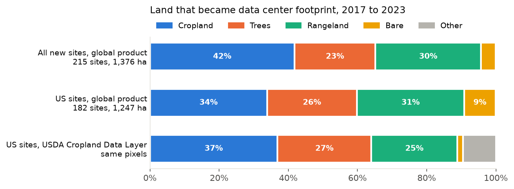
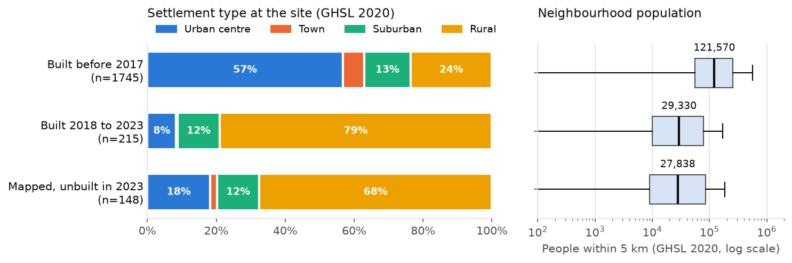
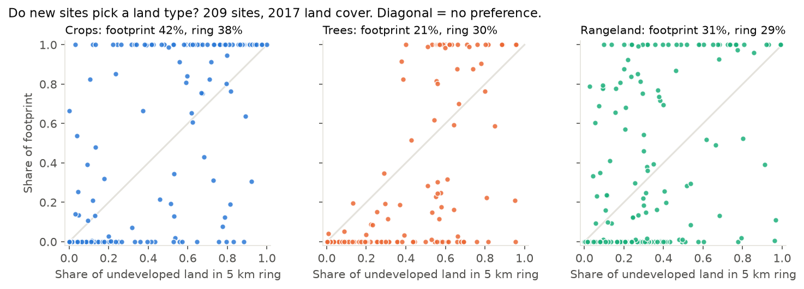

# What land did the data center boom take?

[](https://github.com/YaniceZ/datacenter-land/actions/workflows/tests.yml)

Data centers are now a land use planning problem. Counties rezone farmland for them, residents fight them at council meetings, and moratoriums have spread across the United States and Canada. Water use and local warming around data centers have been studied at global scale. The land itself has not: which fields, forests and grasslands were turned into data center campuses, and how many people live next to them.

This repository answers that for every data center campus mapped in OpenStreetMap, using only open data:

1. **Sites.** 4,127 OSM features tagged `telecom=data_center` or `building=data_center`, merged into 2,378 campuses in 101 countries.
2. **Land before and after.** Annual 10 m land cover (Esri / Impact Observatory, 2017 to 2023) inside each campus footprint. A campus is *new* if under 25% of it was built in 2017 and at least 25% (and at least 1 ha) was built by 2023.
3. **Context.** GHSL 2020 settlement type and population within 5 km.
4. **Choice.** Each new footprint compared with the undeveloped land in a 5 km ring around it, to see whether data centers pick a land type or just take what is there.
5. **Check.** In the US, the pre-construction land class compared pixel by pixel with the USDA Cropland Data Layer.
6. **Now.** Sentinel-2 imagery from summer 2023 and summer 2026 for campuses that were mapped but still unbuilt in 2023.



## Findings

**Cropland is the largest single source.** The 215 campuses built between 2018 and 2023 covered 1,376 ha of land that was not built in 2017: 42% cropland, 31% rangeland (grass and shrub), 23% trees, 4% bare ground. North America accounts for 1,051 ha of it, and the US alone for 73%.

**The global map is close to the national one.** On the 1,247 ha of US conversion, the global product calls 34% of it cropland and the USDA Cropland Data Layer calls 37%. Trees agree within a point (26% vs 27%). Pixel by pixel the two maps agree on 67% of the area; most disagreement is between cropland and rangeland (hay, pasture), and 9% of the land the global product says was undeveloped is already "developed" in the USDA map (mostly low-intensity developed land around existing campuses).

**Data centers have left the city.** 57% of campuses built before 2017 sit in an urban centre and 24% in rural land. Of campuses built in 2018 to 2023, 79% are rural; of those mapped but unbuilt in 2023, 68%. The median new campus is 3.7 ha, eight times the median older one (0.44 ha), and has 29,000 people within 5 km instead of 122,000.



**They take farmland because they go where farmland is, not because they seek it out.** Compared with the undeveloped land in a 5 km ring around each site, new footprints hold about the same share of cropland (42% vs 38%, paired Wilcoxon p = 0.27) and rangeland (31% vs 29%, p = 0.46), and markedly less forest (21% vs 30%, p < 0.001). The 2023 pipeline shows the same pattern: cropland 34% vs 34%, forest 17% vs 29%. In planning terms, the farmland loss follows from the move to rural edge sites; a farmland protection rule would have to steer where campuses go at all, not just which parcel.



**Construction has started on most of the 2023 pipeline.** 148 campuses were mapped in OSM but under 25% built in 2023 (1,966 ha; 1,263 ha without the 703 ha Stargate UAE campus in Abu Dhabi). Sentinel-2 medians from summer 2023 and summer 2026 cover 146 of them. To set a threshold, the same measure was run on 59 campuses already built before 2017: their median changed share is 17%, and 90% of them stay below 72%. 89 of the 146 pipeline campuses (61%, 654 ha) changed more than that or lost at least a quarter of their vegetation, and 336 ha of vegetated land inside pipeline footprints was cleared between 2023 and 2026. Examples: the Amazon campus near New Carlisle, Indiana (81% of 117 ha cleared), Google at Waltham Cross north of London (95% of 12 ha), and a 23 ha campus in Cyberjaya, Malaysia (82%). The measure misses construction on desert: the Stargate UAE footprint changed 41%, below the threshold, although it is being built.

## The dataset

`results/datacenter_sites.geojson` (and `.csv`) has one row per campus: name, operator, country, status, footprint area, built share for every year 2017 to 2023, hectares converted from each land class, settlement type, population within 5 km, the Sentinel-2 change measures for pipeline sites, and the OSM ids it was built from. It is meant to be reused: fix a footprint in OSM and the pipeline picks it up on the next run.

An interactive map of all campuses is in `docs/map.html` (download and open it in a browser).

## Limits

- **OSM is not a census.** Coverage is good in the US and western Europe and thin elsewhere (87 campuses mapped in China, 26 in India). Totals here are for mapped campuses; the shares and comparisons are the main result, not the global hectare total.
- **Canada is a gap in the data, not just in this study.** Alberta alone had at least 42 data center proposals by early 2026, but OSM has five Alberta sites, none of them a recent hyperscale campus. Only two Canadian campuses (an Amazon site near Montreal and a Hut 8 site near Medicine Hat) were built in 2018 to 2023, so the planned Canadian check against NRCan land cover covers 4.7 ha and is not reported as a validation. There is no public register of data center sites and footprints in Canada.
- **Land cover stops in 2023.** The annual 10 m product is not yet published for 2024 or later; the Sentinel-2 step only says whether a pipeline site changed, not what it became.
- **Footprints are what mappers drew.** Some outlines are buildings, some are whole parcels with lawns and ponds. Area-weighted totals favour the parcels.
- **Crypto mining.** Eleven campuses are flagged as crypto mines by name or operator (for example Riot Platforms in Texas) and kept in the counts, since several are being converted to AI hosting. Unnamed mines will not be flagged.
- **Not counted:** power plants, substations and transmission lines built for data centers, which can take more land than the campus itself.

## Reproduce

```bash
python -m venv .venv && .venv/Scripts/activate    # or source .venv/bin/activate
pip install -e ".[dev]"
dcland all          # about 1.5 hours; needs the GHSL and Natural Earth files below
pytest -q
```

Raw inputs: GHSL `GHS_SMOD_E2020_GLOBE_R2023A_54009_1000` and `GHS_POP_E2020_GLOBE_R2023A_54009_1000` in `data/raw/ghsl/`, and Natural Earth 1:50m countries in `data/raw/ne/`. Everything else is read from the Overpass API and the Microsoft Planetary Computer.

## Data

| Data | Use | Licence |
|---|---|---|
| OpenStreetMap via Overpass (downloaded 2026-11-17) | Campus footprints | ODbL |
| Esri / Impact Observatory 10 m Annual Land Cover v02, 2017 to 2023 | Land before and after | CC BY 4.0 |
| USDA NASS Cropland Data Layer 2017 | US check | Public domain |
| NRCan Land Cover of Canada 2015 | Canadian check | OGL Canada |
| GHSL SMOD and POP R2023A, epoch 2020 | Settlement type, population | CC BY 4.0 |
| Copernicus Sentinel-2 L2A | 2023 vs 2026 change | Copernicus open licence |
| Natural Earth | Countries | Public domain |

The derived dataset in `results/` contains OSM-derived geometry and is released under the ODbL; the code is MIT.
