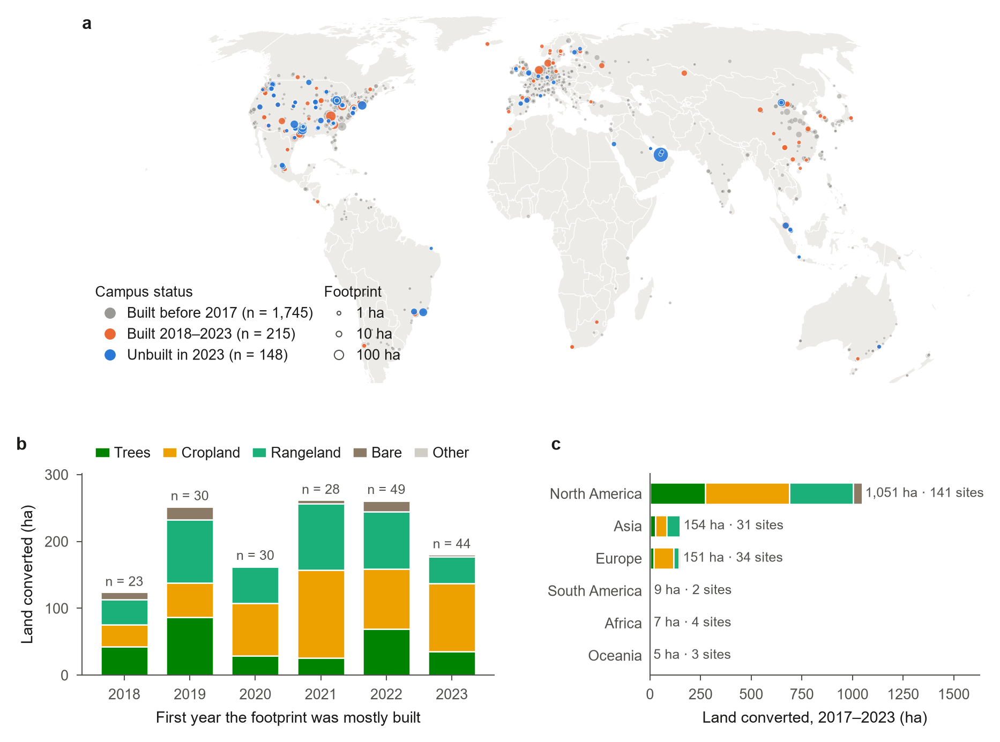
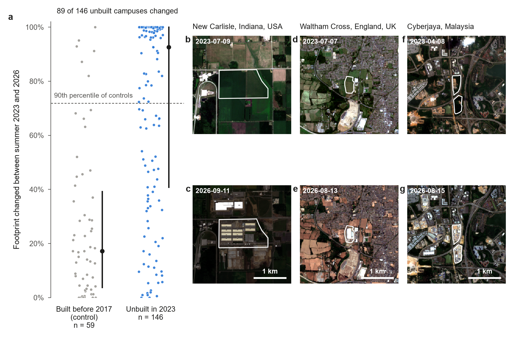

# Data center expansion has moved onto rural land

[](https://github.com/YaniceZ/datacenter-land/actions/workflows/tests.yml)

A global footprint analysis of data center campuses, 2017–2026, built only from open data.

**Project page and interactive map:** https://yanicez.github.io/datacenter-land/

**Manuscript:** [paper/manuscript.md](paper/manuscript.md) (preprint, not peer reviewed) · **Dataset:** [results/datacenter_sites.geojson](results/datacenter_sites.geojson) · **Figures:** [docs/figures](docs/figures) (vector PDF and PNG)

## Summary

Data center growth has become a land use problem, but no one has measured the land it takes at global scale. We combined 2,378 data center campuses mapped in OpenStreetMap across 101 countries with annual 10 m land cover for 2017–2023, Global Human Settlement Layer population and settlement data, and Sentinel-2 imagery from 2023 and 2026.

- **Cropland is the largest source.** The 215 campuses built in 2018–2023 converted 1,376 ha: 41.8% cropland (95% CI 33.0–50.7%), 30.5% rangeland, 23.4% tree cover. At US campuses, the global product and the USDA Cropland Data Layer give similar cropland shares (33.9% and 36.9%).
- **Siting has left the city.** The share of campuses on rural land rose from 23.6% (built before 2017) to 79.1% (built 2018–2023). The median campus became 8.4 times larger, and the median number of residents within 5 km fell from 121,570 to 29,330.
- **Location, not parcel choice, drives the farmland loss.** New footprints contain the same share of cropland as the undeveloped land within 5 km (+4.1 points, 95% CI −0.2 to +8.5, p = 0.27) and less forest (−8.5 points, p < 0.001). Protecting farmland therefore depends on regional siting policy; steering a campus to a different parcel would change little.
- **The 2023 pipeline is being built.** Of 146 campuses mapped but unbuilt in 2023, 89 (654 ha) changed more by 2026 than 90% of established campuses did, and 336 ha of vegetation inside their footprints was cleared.
- **The public record is incomplete.** Most of Canada's 159 proposed hyperscale facilities are planned for Alberta, yet OpenStreetMap shows five Alberta data centers, none of them a recent hyperscale campus. There is no public register of campus footprints.





All headline results hold under alternative built-share thresholds (10%, 50%), after excluding crypto mines, the United States or campuses over 50 ha, and with site weighting instead of area weighting (Extended Data Table 1 in the manuscript).

## Repository

| Path | Contents |
|---|---|
| `src/dcland/osm.py` | Overpass download, polygon repair, grouping polygons into campuses |
| `src/dcland/landcover.py` | Annual 10 m land cover per footprint; footprint versus 5 km ring |
| `src/dcland/classify.py` | Campus status (built before 2017, built 2018–2023, unbuilt in 2023), crypto flag |
| `src/dcland/context.py` | Country, GHSL settlement class, population within 5 km |
| `src/dcland/validate.py` | Pixel cross-tabulation against USDA CDL 2017 and NRCan land cover |
| `src/dcland/sentinel.py` | Sentinel-2 change 2023–2026; true-colour image chips |
| `src/dcland/stats.py` | Site bootstrap intervals, paired tests, sensitivity analyses |
| `src/dcland/figures.py` | Figures 1–5 (183 mm, Arial 7 pt) |
| `src/dcland/website.py` | Compact campus and footprint files for the project page |
| `results/` | `summary.json`, `stats.json`, validation tables, the campus dataset |
| `docs/` | Project page served by GitHub Pages: `index.html`, map data in `docs/data/`, figures |

## Reproduce

```bash
python -m venv .venv && source .venv/bin/activate   # Windows: .venv\Scripts\activate
pip install -e ".[dev]"
dcland all     # about 2 hours, mostly Planetary Computer reads
pytest -q
```

Two inputs must be downloaded by hand into `data/raw/`: the GHSL `GHS_SMOD_E2020_GLOBE_R2023A_54009_1000` and `GHS_POP_E2020_GLOBE_R2023A_54009_1000` rasters (into `ghsl/`), and Natural Earth 1:50m admin-0 countries (into `ne/`). Everything else is read from the Overpass API and the Microsoft Planetary Computer.

## Data and licences

| Data | Use | Licence |
|---|---|---|
| OpenStreetMap via Overpass (17 Nov 2026) | Campus footprints | ODbL |
| Esri / Impact Observatory 10 m Annual Land Cover v02, 2017–2023 | Land before and after | CC BY 4.0 |
| USDA NASS Cropland Data Layer 2017 | US validation | Public domain |
| NRCan Land Cover of Canada 2015 | Canadian check | OGL Canada |
| GHSL SMOD and POP R2023A, epoch 2020 | Settlement type, population | CC BY 4.0 |
| Copernicus Sentinel-2 L2A | 2023–2026 change, image chips | Copernicus licence |
| Natural Earth 1:50m | Countries, base map | Public domain |

The campus dataset in `results/` is derived from OpenStreetMap and released under the ODbL. The code is MIT.

## Citation

Zeng, Y. Data center expansion has moved onto rural land: a global footprint analysis, 2017–2026. Preprint (2026). https://github.com/YaniceZ/datacenter-land
