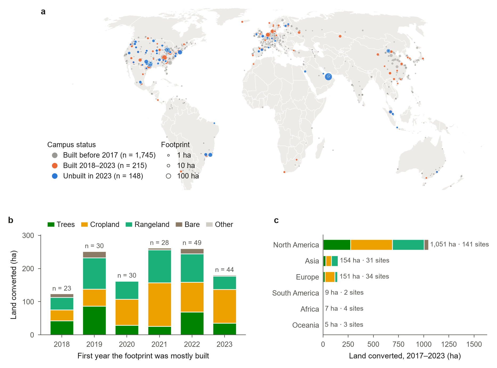
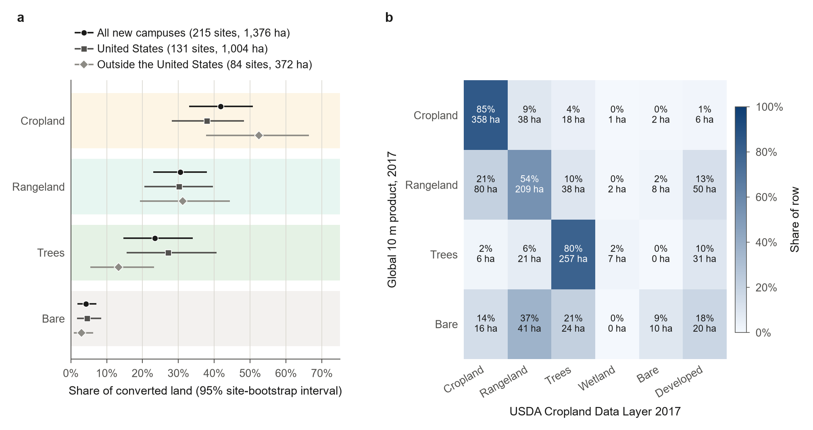
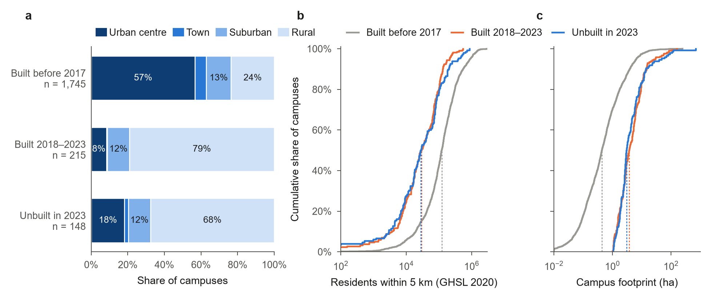
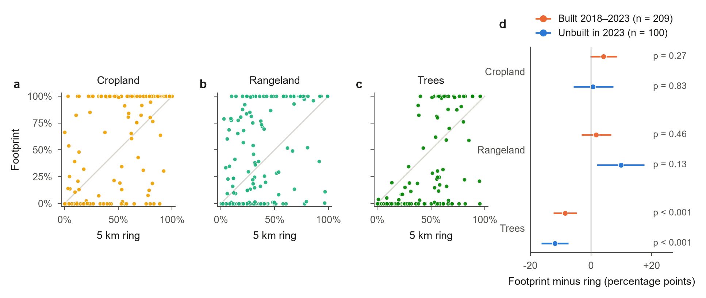
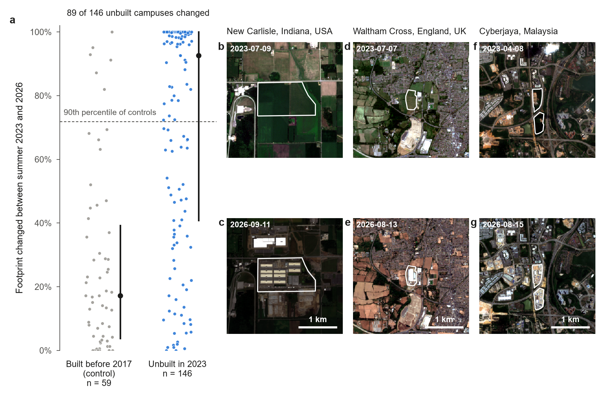

# Data center expansion has moved onto rural land: a global footprint analysis, 2017–2026

**Yanice Zeng**

Independent researcher

*Preprint, not peer reviewed. Version 1, November 2026.*

---

## Abstract

The growth of artificial intelligence has made data centers a land use question as well as an energy one. Their water demand and local heat have been assessed globally, but the land they occupy has not. We combined 2,378 data center campuses mapped in OpenStreetMap across 101 countries with annual 10 m land cover (2017–2023), Global Human Settlement Layer population and settlement data, and Sentinel-2 imagery from 2023 and 2026. The 215 campuses built between 2018 and 2023 converted 1,376 ha, of which 41.8% (95% CI 33.0–50.7%) had been cropland, 30.5% rangeland and 23.4% tree cover. In the United States, the global land cover product and the USDA Cropland Data Layer gave similar cropland shares (33.9% and 36.9%). Siting has shifted away from cities. Of campuses built before 2017, 23.6% were on rural land; of those built in 2018–2023, 79.1% were (95% CI 73.5–84.7%). The median new campus was 8.4 times larger and had a quarter as many residents within 5 km. New footprints held the same share of cropland as the undeveloped land around them (difference +4.1 percentage points, 95% CI −0.2 to +8.5) and less forest (−8.5 points, −12.4 to −4.7). Cropland loss therefore follows from where campuses are sited at the regional scale, not from parcel choice. Of 146 campuses still unbuilt in 2023, 89 showed construction-scale change by 2026. We release the campus-level dataset, which we believe is the first open, global, footprint-based inventory of data center land conversion.

## Introduction

Data centers were long an urban building type: a few hectares inside an office park or industrial zone, close to fibre and customers. The electricity demand of large AI training and inference clusters has changed this. Recent campuses are planned at hundreds of megawatts and tens to hundreds of hectares, and are placed where grid capacity, land and permission can be secured quickly1,2. Local planning has struggled to keep up, and moratoriums and rezoning disputes over farmland have become common3,8. In Canada, 159 hyperscale facilities of more than 50 MW were proposed or under construction in 2026, most of them in Alberta4. There is no public register of where they would be built.

The environmental footprint of data centers has mostly been studied through energy1,5 and, more recently, water and heat. One quarter of 9,347 operational data centers sit in areas that are water-stressed at least one month a year6. A preprint reports that land surface temperature rises by about 2 °C around AI data centers after they open7. The land itself has received less attention. A planning literature is emerging on how zoning codes should treat data centers3,8, but there is no global, measured account of what land campuses replace or who lives next to them. Practitioner and press analyses of selected US sites exist, but they are neither systematic nor open.

This study measures three things for every campus mapped in OpenStreetMap: the land cover that campuses converted between 2017 and 2023, the settlement context of old and new campuses, and whether new campuses select particular land types or simply take what is available nearby. We check the global land cover product against an independent national map, and use Sentinel-2 imagery to extend the record to summer 2026 for campuses that were mapped but still unbuilt in 2023.

## Results

### A global inventory of campus footprints

OpenStreetMap held 4,127 polygons tagged as data centers in November 2026. Merging polygons within 150 m of each other gave 2,378 campuses in 101 countries (Fig. 1a). Using the share of each footprint mapped as built in 2017 and 2023, we classed 1,745 campuses as built before 2017 and 215 as built between 2018 and 2023. A further 148 were mapped in OSM but still less than 25% built in 2023. The remaining 270 were too small to classify or had no land cover. The inventory is densest in the United States (831 campuses) and western Europe. Coverage elsewhere is thin: 87 campuses are mapped in China and 26 in India. Totals below therefore describe mapped campuses, not all data centers worldwide.

### Cropland was the largest source of converted land

The 215 campuses built in 2018–2023 converted 1,376 ha that was not built in 2017 (Fig. 1b,c). Of this, 41.8% (95% CI 33.0–50.7%, site-level bootstrap) was cropland, 30.5% (23.0–37.9%) rangeland (grass and shrub), 23.4% (14.7–34.0%) tree cover and 4.2% (1.9–7.1%) bare ground (Fig. 2a). North America accounted for 1,051 ha and the United States alone for 73%. Outside the United States, cropland made up a larger share (52.4%, 37.7–66.4%) and tree cover a smaller one (13.3%, 5.5–23.2%). Converted area did not grow steadily from year to year. It ranged from 124 ha for campuses first built in 2018 to 262 ha in 2021 and 2022.

The global product agrees well with the USDA Cropland Data Layer 20179 at US campuses (Fig. 2b). On the 1,247 ha of US land that changed from not built to built at any campus, the global product classed 33.9% as cropland and the USDA map 36.9%. Tree cover agreed within 1.2 points (25.9% and 27.1%). Of the land the global product called cropland, 85% was cropland in the USDA map, and it captured 78% of the USDA cropland. Most disagreement was between rangeland and cropland, which is expected for hay and pasture. In addition, 8.6% of the converted land was already classed as developed in the USDA map, mostly low-intensity development at the edge of existing campuses. Overall pixel agreement across all classes was 66.9%.

### Siting has moved from urban centres to rural land

Campuses built before 2017 were mainly urban: 57% were in a GHSL urban centre10,11 and 23.6% (21.7–25.6%) on rural land (Fig. 3a). Of campuses built in 2018–2023, 79.1% (73.5–84.7%) were on rural land. So were 67.6% (59.5–75.0%) of those unbuilt in 2023. Median campus size rose from 0.44 ha before 2017 to 3.69 ha (2.98–4.69) for new campuses (Fig. 3c). The median number of residents within 5 km fell from 121,570 (114,211–131,319) to 29,330 (22,162–40,569) (Fig. 3b). The two later cohorts have almost identical distributions, which suggests the shift continued after 2023.

### New campuses take the land around them, except forest

If campuses sought out farmland, their footprints should contain more cropland than the surrounding landscape. We compared each footprint with the undeveloped land in a ring extending 5 km from its edge (Fig. 4). For campuses built in 2018–2023, judged on 2017 land cover, the footprint cropland share was 41.8% on average and the ring share 37.7%. The mean paired difference was +4.1 percentage points (95% CI −0.2 to +8.5; Wilcoxon signed-rank p = 0.27). Rangeland showed no difference either (+1.7 points, −3.1 to +6.6; p = 0.46). Tree cover was clearly under-represented in footprints (−8.5 points, −12.4 to −4.7; p < 0.001). Campuses unbuilt in 2023, judged on 2023 land cover, gave the same result: cropland +0.6 points (p = 0.83) and tree cover −11.9 points (−16.4 to −7.5; p < 0.001). The forest difference is not significant when shares are pooled by area (−3.2 points, −12.1 to +7.7), so it is driven by the many smaller campuses rather than the few large ones.

### Construction on the 2023 pipeline

The 148 campuses unbuilt in 2023 cover 1,966 ha. Of this, 703 ha is a single campus, Stargate UAE in Abu Dhabi. We compared cloud-masked Sentinel-2 composites from the 2023 and 2026 growing seasons inside 146 of these footprints. Fifty-nine campuses built before 2017 served as a control. In the controls, a median 17.2% of the footprint changed, and 90% of controls stayed below 71.9%. Eighty-nine of the 146 pipeline campuses (61%, 654 ha) exceeded that threshold or lost at least a quarter of their vegetation (Fig. 5a). In total, 336 ha of vegetated land inside pipeline footprints was cleared between 2023 and 2026. Examples include 81% of a 117 ha cropland campus near New Carlisle, Indiana, and 95% of a 12 ha grass field at Waltham Cross, north of London (Fig. 5b–g). The count depends on the threshold: 107 campuses at the 80th control percentile and 76 at the 95th (Extended Data Table 2). The method misses construction on desert. The Stargate UAE footprint changed by 41%, below the threshold, although construction there has been reported.

### Robustness

The main results hold under alternative definitions (Extended Data Table 1). With a built-share threshold of 10% or 50% instead of 25%, the cropland share of converted land is 44.5% or 39.0%, and 79.4% or 76.1% of new campuses are rural. The cropland share is 42.8% after excluding the 11 campuses flagged as crypto-mining operations and 42.6% after excluding footprints over 50 ha. Weighting each site equally rather than by area gives 42.8%. The rural shift appears outside the United States as well: 15.9% of older and 66.7% of newer campuses are rural.

## Discussion

Data center growth between 2018 and 2023 converted mostly agricultural land, and most of it at rural sites. The amount is small in absolute terms. At 1,376 ha for mapped campuses, it is a rounding error in global cropland, and these figures cover only part of the true total. The significance for planning lies in where the conversion happens and how quickly. Campuses are now eight times larger than before, they are going to places with fewer residents and less planning capacity, and many of the 2023 pipeline sites were cleared within three years.

The ring comparison matters for policy. Campuses do not take farmland disproportionately compared with the land available near them, so measures aimed at the parcel, such as steering a campus to a less productive field, will not change much. The farmland follows from the regional decision to build in agricultural areas with cheap land and grid access. If jurisdictions want to protect farmland, the lever is regional: designating where large-load development may go and tying it to transmission planning. Case-by-case rezoning cannot do this. Forest is avoided at most sites, plausibly because clearing costs more and needs more permits. Those protections appear to work, and the same effect could be achieved for farmland through explicit designation.

The Canadian case shows an information gap. Most of Canada's 159 proposed hyperscale facilities are planned for Alberta4, yet OpenStreetMap contains five Alberta data centers, none of them a recent hyperscale campus. Only two Canadian campuses were built in 2018–2023, so our planned check against NRCan land cover covered 4.7 ha and is not reported as a validation. Public interest in data center siting has outgrown the public record. A register of approved and proposed campuses with footprint boundaries would let the analysis presented here run continuously.

This study has five main limitations. First, OpenStreetMap completeness varies widely between and within countries12,13, so the inventory under-represents China, India, Africa and South America. Second, OSM footprints are drawn by volunteers. Some outline buildings and others whole parcels, which inflates the area of parcel-mapped campuses. Third, the annual 10 m product ends in 202314. The Sentinel-2 step detects change after 2023 but does not classify what replaced the land. Fourth, the ring comparison treats all undeveloped land within 5 km as available. It ignores parcel size, ownership and zoning, which also shape siting. Fifth, we did not count the land taken by power plants, substations and transmission lines built for data centers, which may exceed the campus area. Our estimates are therefore a lower bound on the land cost of the data center boom.

## Methods

**Campus inventory.** We queried the Overpass API on 17 November 2026 for ways and relations tagged `telecom=data_center`, `building=data_center` or `industrial=data_center`. We kept closed rings and multipolygon relations, repaired invalid geometries with a zero-width buffer, and projected them to World Cylindrical Equal Area. Polygons whose 75 m buffers touched were grouped into one campus. The campus footprint is the union of the original polygons, not of the buffers. Name, operator and start date were taken from the first polygon in the group with a non-empty value. Campuses whose name or operator matched a list of crypto-mining terms and companies were flagged (n = 11).

**Land cover.** We used the Esri/Impact Observatory 10 m Annual Land Use Land Cover product (version 2, 2017–2023)14, read as cloud-optimised GeoTIFFs from the Microsoft Planetary Computer. For each campus and year we recorded the share of footprint pixels classed as built area. A campus was classed as built before 2017 if this share was at least 25% in 2017. It was classed as built in 2018–2023 if the share was below 25% in 2017, at least 25% in 2023, and at least 1 ha had changed to built. It was classed as unbuilt in 2023 if the share was below 25% in 2023 and the footprint was at least 1 ha. Converted land is the area of pixels that were not built (and not no data) in 2017 and built in 2023, tabulated by 2017 class. The first built year is the first year after which the built share stays at or above 50%.

**Settlement context.** Each campus's representative point was assigned the GHSL Degree of Urbanisation class (GHS-SMOD R2023A, 2020, 1 km)10,11. Classes were grouped into urban centre (30), dense or semi-dense town (22–23), suburban or peri-urban (21) and rural (11–13). Residents within 5 km are the sum of GHS-POP R2023A 2020 cells whose centres fall within 5 km of that point. Countries come from Natural Earth 1:50m boundaries (nearest polygon, up to 50 km).

**Surroundings.** For each new campus (2017 land cover) and each campus unbuilt in 2023 (2023 land cover), we compared the land cover of the footprint with that of a ring from the footprint edge out to 5 km. Shares were computed over undeveloped classes (cropland, trees, rangeland, bare, flooded vegetation), excluding built land and water, which are not available for a new campus. Campuses with less than 0.5 ha of undeveloped land in the footprint were excluded (new: 209 of 215 retained; unbuilt in 2023: 100 of 148). We tested per-site differences with the Wilcoxon signed-rank test and report bootstrap intervals for both the mean per-site difference and the area-pooled difference.

**Validation.** For US campuses with at least 0.5 ha of conversion (182 campuses, 1,247 ha), we resampled the USDA NASS Cropland Data Layer 2017 (30 m)9 onto the 10 m grid by nearest neighbour and cross-tabulated it against the global product for converted pixels. CDL classes were grouped as cropland (all crop, hay, fallow and orchard codes), trees (63, 141–143), rangeland (64, 152, 176), wetland (87, 190, 195), bare (131), developed (121–124) and water (111). The same procedure with NRCan Land Cover of Canada 2015 was possible for only five campuses (4.7 ha) and is not interpreted. Because neither map is ground truth, we report agreement, not accuracy15.

**Construction after 2023.** For each campus unbuilt in 2023, we selected up to five Sentinel-2 L2A scenes16 with less than 20% cloud cover from the growing season of 2023 and of 2026 (June–September north of 23.5° N, December–March south of 23.5° S, the full year in between), all on one MGRS tile. Pixels flagged as cloud, cloud shadow, cirrus, snow, saturated or no data in the scene classification layer were masked. We took the per-pixel median of red and near-infrared reflectance after removing the processing-baseline offset. A footprint pixel counted as changed if NDVI changed by more than 0.2 or red reflectance by more than 0.05. It counted as cleared if NDVI was at least 0.4 in 2023 and below 0.4 in 2026. The same measure on 60 randomly drawn campuses built before 2017 (59 with valid data) defined the background rate. A pipeline campus counted as started if its changed share exceeded the 90th percentile of the controls or at least 25% of its footprint was cleared.

**Statistics.** Confidence intervals are 2.5th and 97.5th percentiles of 5,000 site-level bootstrap replicates (seed 20261117), resampling campuses with replacement. Area-weighted shares are recomputed from resampled hectares, so large campuses carry more weight.

## Data availability

The campus dataset (GeoJSON and CSV, one row per campus with footprint, status, annual built share, converted hectares by class, settlement type, population and Sentinel-2 change measures) is archived on Zenodo (https://doi.org/10.5281/zenodo.24331630) and available at https://github.com/YaniceZ/datacenter-land under the Open Database License, as it is derived from OpenStreetMap. Input data are openly available from OpenStreetMap, the Microsoft Planetary Computer (Esri/Impact Observatory land cover, USDA Cropland Data Layer, NRCan land cover, Sentinel-2 L2A), the European Commission Joint Research Centre (GHSL) and Natural Earth.

## Code availability

All code is at https://github.com/YaniceZ/datacenter-land (MIT licence) and archived with the dataset at https://doi.org/10.5281/zenodo.24331630. `dcland all` reproduces every number and figure from public inputs.

## Acknowledgements

Analysis code was written with the assistance of an AI coding tool (Claude, Anthropic). The author designed the study, checked the code and outputs, and is responsible for the content.

## References

1. Masanet, E., Shehabi, A., Lei, N., Smith, S. & Koomey, J. Recalibrating global data center energy-use estimates. *Science* **367**, 984–986 (2020).
2. International Energy Agency. *Energy and AI* (IEA, 2025).
3. Zwick, A. Something wired this way comes: what fracking taught planners that data center communities need to learn. *J. Am. Plann. Assoc.* 1–7 (2026). https://doi.org/10.1080/01944363.2026.2710901
4. Enoch, S. & Pettigrew, R. *Data Centre Regulation in the Public Interest: A Closing Window of Opportunity in Canada* (Canadian Centre for Policy Alternatives, 2026).
5. Shehabi, A. et al. *2024 United States Data Center Energy Usage Report* (Lawrence Berkeley National Laboratory, 2024).
6. Rosa, L. et al. One quarter of global data centers are located in water-stressed areas. *Environ. Sci. Technol.* (2026). https://doi.org/10.1021/acs.est.6c08088
7. Marinoni, A. et al. The data heat island effect: quantifying the impact of AI data centers in a warming world. Preprint at https://arxiv.org/abs/2603.20897 (2026).
8. Nichols, C. The physical footprint of artificial intelligence. *Zoning Practice* (American Planning Association, October 2025).
9. Boryan, C., Yang, Z., Mueller, R. & Craig, M. Monitoring US agriculture: the US Department of Agriculture, National Agricultural Statistics Service, Cropland Data Layer Program. *Geocarto Int.* **26**, 341–358 (2011).
10. Dijkstra, L. et al. Applying the Degree of Urbanisation to the globe: a new harmonised definition reveals a different picture of global urbanisation. *J. Urban Econ.* **125**, 103312 (2021).
11. European Commission, Joint Research Centre. *GHSL Data Package 2023* (Publications Office of the European Union, 2024). https://doi.org/10.2760/098587
12. Barrington-Leigh, C. & Millard-Ball, A. The world's user-generated road map is more than 80% complete. *PLoS ONE* **12**, e0180698 (2017).
13. Herfort, B., Lautenbach, S., Porto de Albuquerque, J., Anderson, J. & Zipf, A. A spatio-temporal analysis investigating completeness and inequalities of global urban building data in OpenStreetMap. *Nat. Commun.* **14**, 3985 (2023).
14. Karra, K. et al. Global land use / land cover with Sentinel 2 and deep learning. In *2021 IEEE International Geoscience and Remote Sensing Symposium (IGARSS)* 4704–4707 (IEEE, 2021).
15. Olofsson, P. et al. Good practices for estimating area and assessing accuracy of land change. *Remote Sens. Environ.* **148**, 42–57 (2014).
16. Drusch, M. et al. Sentinel-2: ESA's optical high-resolution mission for GMES operational services. *Remote Sens. Environ.* **120**, 25–36 (2012).

## Figure legends

**Fig. 1 | Data center campuses and the land converted by new campuses.** **a**, 2,378 campuses mapped in OpenStreetMap, by status. Marker area scales with footprint. Equal Earth projection. **b**, Land converted to built area at the 215 campuses built in 2018–2023, by the first year the footprint was mostly built and by 2017 land class. **c**, The same by continent.

**Fig. 2 | What the land was before construction.** **a**, Share of converted land by 2017 class for all new campuses, for US campuses and for campuses elsewhere. Lines are 95% site-bootstrap intervals (5,000 replicates). **b**, Agreement between the global 10 m product (rows) and the USDA Cropland Data Layer 2017 (columns) on 1,247 ha of converted land at 182 US campuses. Cells give the row share and hectares.

**Fig. 3 | The move away from cities.** **a**, GHSL Degree of Urbanisation class at campuses built before 2017, built in 2018–2023 and unbuilt in 2023. **b**, Cumulative distribution of residents within 5 km (GHSL 2020). **c**, Cumulative distribution of footprint area. Dotted lines mark medians.

**Fig. 4 | Footprints compared with the land around them.** **a–c**, Share of undeveloped land in each new campus footprint (2017) against the share in a 5 km ring, for cropland, rangeland and trees. The diagonal marks no preference. **d**, Mean per-site difference (footprint minus ring) with 95% bootstrap intervals and Wilcoxon signed-rank p values, for campuses built in 2018–2023 (2017 land cover) and campuses unbuilt in 2023 (2023 land cover).

**Fig. 5 | Construction since 2023 on campuses that were unbuilt in 2023.** **a**, Share of each footprint whose Sentinel-2 surface changed between the 2023 and 2026 growing seasons, for 59 campuses built before 2017 (control) and 146 unbuilt in 2023. Black bars show the interquartile range and median. The dashed line is the 90th percentile of controls. **b–g**, Sentinel-2 true-colour images (10 m) before and after construction, with the OSM footprint in white. Each image is contrast-stretched separately (1st–99th percentile). Contains modified Copernicus Sentinel data 2023 and 2026.

## Extended Data

**Extended Data Table 1 | Sensitivity of the main results.**

| Variant | New campuses | Converted (ha) | Cropland share | Tree share | Rural, new | Rural, pre-2017 |
|---|---:|---:|---:|---:|---:|---:|
| Main analysis (built share 25%) | 215 | 1,376 | 41.8% | 23.4% | 79.1% | 23.6% |
| Built share threshold 10% | 209 | 1,311 | 44.5% | 22.8% | 79.4% | 24.3% |
| Built share threshold 50% | 230 | 1,380 | 39.0% | 22.7% | 76.1% | 22.7% |
| Excluding crypto-flagged campuses | 212 | 1,339 | 42.8% | 22.8% | 78.8% | 23.5% |
| Excluding the United States | 84 | 372 | 52.4% | 13.3% | 66.7% | 15.9% |
| Excluding footprints over 50 ha | 208 | 1,032 | 42.6% | 21.0% | 78.4% | 23.4% |
| Site-weighted shares | 215 | 1,376 | 42.8% | 20.5% | – | – |

**Extended Data Table 2 | Campuses unbuilt in 2023 that changed by 2026, by control threshold.**

| Control percentile | Changed-share threshold | Campuses started (of 146) | Area (ha) |
|---|---:|---:|---:|
| 80th | 46.2% | 107 | 919 |
| 90th (main) | 71.9% | 89 | 654 |
| 95th | 91.4% | 76 | 577 |

A campus also counts as started if at least 25% of its footprint lost vegetation (NDVI ≥ 0.4 in 2023, < 0.4 in 2026).
